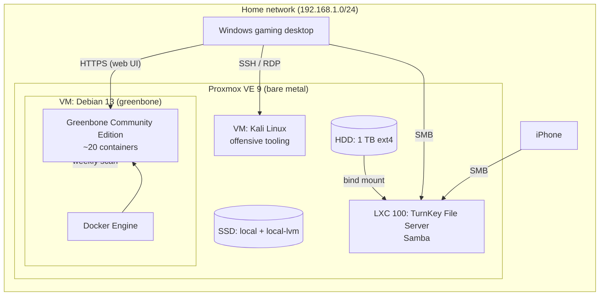

# Homelab: Repurposed Desktop → Proxmox Virtualization Server

A self-hosted home server built from an old desktop. It provides network file storage, isolated virtual machines for security tooling, and automated weekly vulnerability scanning of my home network.

## Goals

- **Network storage** shared to Windows and iOS devices
- **Virtualization** for isolated lab environments
- **Security assessment** of my own home network with scheduled vulnerability scans

## Hardware

| Component | Spec | Role |
|---|---|---|
| CPU | 12 x Intel(R) Core(TM) i7-8700 CPU @ 3.20GHz | Supports hardware virtualization (VT-x) |
| RAM | 16 GB | Shared across host, containers, and VMs |
| SSD | 256 GB | Proxmox OS + VM/container disks (LVM-thin) |
| HDD | 1 TB | Network file storage (ext4) |

## Architecture

## Components

| # | Component | Type | Purpose | Docs |
|---|---|---|---|---|
| 1 | Proxmox VE | Bare-metal hypervisor | Runs all VMs and containers | [01-proxmox.md](docs/01-proxmox.md) |
| 2 | TurnKey File Server | LXC container | Samba share backed by the 1 TB HDD | [02-file-server.md](docs/02-file-server.md) |
| 3 | Kali Linux | KVM virtual machine | Penetration testing and network analysis | [03-kali-vm.md](docs/03-kali-vm.md) |
| 4 | Greenbone (OpenVAS) | Docker on a Debian VM | Scheduled weekly vulnerability scans | [04-greenbone.md](docs/04-greenbone.md) |

Problems I hit and how I solved them are in [troubleshooting.md](docs/troubleshooting.md).

## Design Decisions

- **Proxmox over bare-metal Linux Server as the base OS.** Proxmox is purpose-built for virtualization, with KVM, LXC, ZFS, snapshots, backups, and a web UI integrated. Other distros would mean assembling and maintaining those pieces separately.
- **Samba in an LXC container instead of TrueNAS.** With a single storage disk, TrueNAS's main strengths (ZFS redundancy, RAIDZ) don't apply, and it reserves about 8 GB of RAM. The container uses under 1 GB.
- **Containers vs. VMs chosen per workload.**
  - Samba is a simple Linux service, so it runs in a lightweight LXC container.
  - Kali gets a full VM for its own kernel and strong isolation for low-level network tooling.
  - Greenbone runs as Docker containers inside a dedicated VM, which combines Docker's simple upgrades with VM-level isolation.
- **Thin provisioning.** VM disks live on LVM-thin with Discard and SSD emulation enabled, so deleted guest data is reclaimed on the physical SSD.
- **Ports to be or not to be exposed to the internet.** That decision will come later when I decide in what capacity would I be remotely accessing my server.

## Resource Budget

| Workload | RAM | Disk |
|---|---|---|
| Proxmox host | ~2 GB | — |
| File server (LXC) | 1 GB | 8 GB |
| Kali VM | 4 GB | 40 GB |
| Greenbone VM | 8 GB (4 GB minimum, ballooning) | 60 GB |

Kali is kept powered off when not in use so Greenbone has memory headroom during scans.

## Skills Demonstrated

- Bare-metal hypervisor installation and administration (Proxmox VE / KVM / LXC)
- Linux system administration (Debian, Kali, apt, systemd, permissions)
- Storage provisioning (disk formatting, LVM-thin, bind mounts)
- Network file sharing across platforms (Samba/SMB for Windows and iOS)
- Container orchestration with Docker and Docker Compose
- Vulnerability management (Greenbone/OpenVAS scan targets, tasks, schedules, feed updates)
- Troubleshooting: unprivileged container UID mapping, SMB authentication, Apple SMB compatibility, package source configuration
